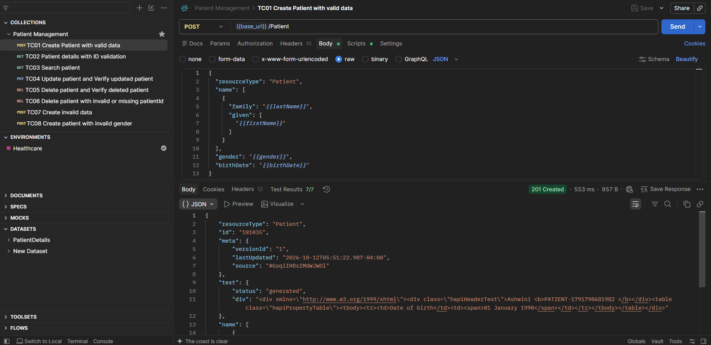
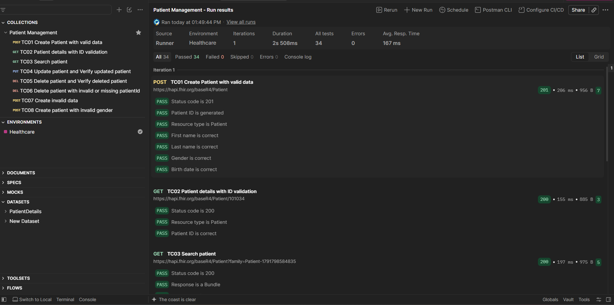
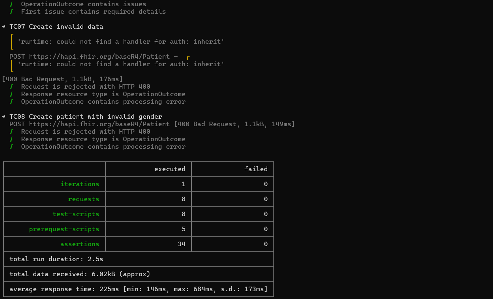
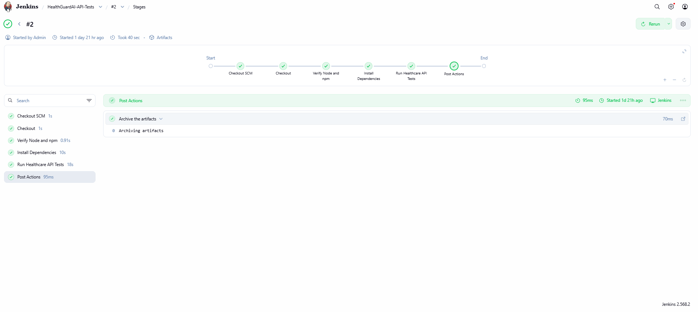
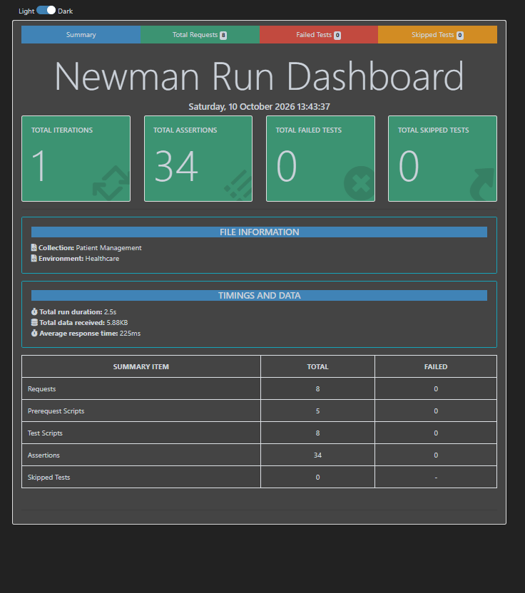

# HealthGuard AI — Healthcare API Automation & CI/CD

## Project Overview

A personal QA automation project demonstrating healthcare REST API testing using Postman and Newman, with Jenkins CI/CD integration and automated HTML reporting.

## Tech Stack

- **API Testing:** Postman, Newman
- **Scripting:** JavaScript assertions
- **Data:** JSON, CSV
- **API Standard:** FHIR R4
- **CI/CD:** Jenkins
- **Version Control:** Git, GitHub
- **Reporting:** Newman HTML Extra Reporter

## Test Coverage

- Patient CRUD operations
- Patient search and retrieval
- Positive and negative scenarios
- HTTP status-code and response-body assertions
- CSV-driven test data
- Automated command-line execution
- Jenkins pipeline execution and HTML report archiving

## Execution Results

- **Postman Collection Runner:** 34 assertions passed
- **Newman CLI:** 8 requests, 34 assertions, 0 failed
- **Jenkins:** Successful pipeline execution
- **Reporting:** HTML report generated and archived

## Project Evidence

### 1. Create Patient — Postman API Validation

Successful Patient resource creation using a parameterized POST request.



### 2. Postman Collection Runner

Collection execution with 34 passing assertions.



### 3. Newman CLI Execution

Command-line execution of the Postman collection.



### 4. Jenkins CI/CD Pipeline

Automated checkout, dependency installation, API test execution, and report archiving.



### 5. Newman HTML Report

HTML report summarizing API test execution.



## How to Run

Install Node.js and npm, then run:

```bash
npm ci
```

Execute the API test collection:

```bash
npx newman run Healthcare-API.postman_collection.json -e Healthcare.postman_environment.json
```

Generate the HTML report:

```bash
npx newman run Healthcare-API.postman_collection.json -e Healthcare.postman_environment.json -r cli,htmlextra --reporter-htmlextra-export healthcare-api-report.html
```

## Learning Outcomes

- REST API test design and response validation
- Data-driven testing using CSV
- Negative testing and assertion design
- Newman CLI execution
- Jenkins CI/CD integration
- Automated test reporting and troubleshooting

## Disclaimer

This is a personal learning project using a public FHIR test server. It is not a production healthcare application and does not contain real patient data.
